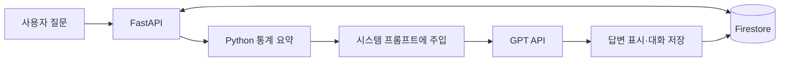

# Pulse · 서버 메트릭 AI 비서

**과제: AI Agent 개발 — 나만의 AI 비서 구축**

가상 서버 `demo-01`의 CPU·메모리 사용률을 저장·분석하고, 데이터 요약을 근거로 질문에 답하는 웹서비스입니다. FastAPI, Firebase Firestore, GPT API와 바닐라 HTML/CSS/JavaScript를 연결했습니다.

> **데이터 안내:** 모든 관측값은 직접 생성한 합성 데이터입니다. 기간은 2026-11-01~2026-11-14 KST이며 실시간 서버 상태를 나타내지 않습니다. 높은 사용률만으로 실제 장애나 메모리 누수를 확정하지 않습니다.

## 동료평가 시작하기

Python 설치나 개인 API 키 입력 없이 배포된 서비스에서 주요 기능을 확인할 수 있습니다.

| 확인 대상 | 바로 가기 | 확인할 내용 |
| --- | --- | --- |
| 배포 서비스 | [Pulse 열기](https://pulse-server-ai.vercel.app) | 대시보드, 채팅, 데이터 관리, 대화 기록 |
| 백엔드 API | [상태 확인](https://pulse-server-ai.onrender.com/api/health) | `production`, `firestore`, `openai` 설정 |
| API 문서 | [Swagger UI](https://pulse-server-ai.onrender.com/docs) | 요청 형식, 데이터 검증, 각 API 응답 |
| 데이터 요약 | [요약 API](https://pulse-server-ai.onrender.com/api/data/summary) | 기간·개수·통계·추세 |
| 배포 검증 기록 | [검증 결과 JSON](evidence/deployment-checks.json) | 실제 GPT 응답, CRUD, Firestore 대화 저장·불러오기 검증 |

Render 무료 서비스의 첫 요청은 서버 시작 때문에 지연될 수 있습니다. 연결을 기다린 뒤 다시 시도해 주세요. 배포 서비스의 채팅은 실제 GPT API를 사용합니다.

## 5분 평가 순서

| 순서 | 조작 방법 | 기대 결과 |
| --- | --- | --- |
| 1. 요약 확인 | **대시보드**에서 사용률 카드, 그래프, `데이터에서 확인한 것`을 확인합니다. | 관측 기간·개수와 CPU·메모리 통계가 표시됩니다. |
| 2. 데이터 기반 질문 | 오른쪽 채팅에서 **“CPU가 가장 높았던 때는 언제야?”**를 전송합니다. | 로딩 표시 후 최고 사용률과 관측 시각을 포함한 답변이 나타납니다. |
| 3. 추가 질문 | **“메모리 사용 추세는 어때?”**를 전송합니다. | 저장된 관측값의 최근 24시간과 직전 24시간을 비교합니다. |
| 4. CRUD 확인 | **데이터 관리**에서 메트릭·관측 시각·사용률을 입력하고, 메모에 `동료평가-본인이니셜`을 적어 추가합니다. 이어서 본인이 추가한 값의 수정·삭제를 확인합니다. | 목록과 요약이 갱신되고, 삭제 후 테스트 관측값이 사라집니다. |
| 5. 대화 불러오기 | 채팅 상단 **＋**로 새 대화를 시작한 뒤 **대화 기록 → 불러오기**를 누릅니다. | 이전 질문과 답변이 다시 표시되며 이어서 질문할 수 있습니다. |
| 6. 내보내기 확인 | **데이터 관리 → CSV 내보내기**를 누릅니다. | 현재 관측값을 담은 CSV 파일을 내려받습니다. |

평가 중에는 본인이 추가한 테스트 관측값을 수정·삭제해 주세요. 배포 데이터는 평가자가 변경할 수 있으므로, 아래 초기 수치와 현재 화면의 값은 달라질 수 있습니다.

## 과제 요구사항별 확인 위치

| 요구사항 | 구현 내용 | 확인 위치 |
| --- | --- | --- |
| 시계열 데이터 100개 이상 | CPU 336개 + 메모리 336개, 초기 관측값 총 672개 | [데이터 생성 코드](scripts/generate_data.py), [생성 메타데이터](data/manifest.json) |
| 데이터 분석·요약 | 기간, 개수, 평균·최솟값·최댓값, 최근 추세, 일별 집계 | [요약 계산](backend/app/summary.py), 대시보드, `/api/data/summary` |
| FastAPI 구성·Swagger | 앱 초기화, 라우터, 모델, 저장소, AI·요약 처리 분리 | [앱 구성](backend/app/main.py), [라우터](backend/app/routes.py), [Swagger](https://pulse-server-ai.onrender.com/docs) |
| Pydantic 요청 검증 | 시간대가 있는 날짜, 사용률 0~100, 메트릭 종류, 입력 길이 검증 | [요청 모델](backend/app/models.py), [테스트](tests/test_app.py) |
| Firestore 연동 | `data`, `conversations` 컬렉션에 저장 | [저장소 구현](backend/app/repository.py), [배포 설정](DEPLOYMENT.md) |
| 데이터 CRUD API | 추가·목록 조회·수정·삭제와 요약 API | [라우터](backend/app/routes.py), 데이터 관리 화면 |
| 데이터 기반 AI 채팅 | 매 요청에서 요약을 다시 계산하고 시스템 프롬프트에 주입 | [GPT 호출·프롬프트](backend/app/ai.py), 채팅 화면 |
| 대화 기록 | 채팅 자동 저장, 목록·상세 조회, 불러오기, 이어가기, 삭제, 사본 저장 | [대화 API](backend/app/routes.py), 대화 기록 화면 |
| 바닐라 프론트엔드 | HTML/CSS/JavaScript로 채팅·로딩·요약·CRUD·대화 기록 구현 | [HTML](frontend/index.html), [JavaScript](frontend/app.js), [CSS](frontend/style.css) |
| CORS·환경변수·예외 처리 | 허용 도메인 지정, 서버 키 관리, 입력·연결·AI 오류 안내 | [설정](backend/app/config.py), [앱 구성](backend/app/main.py), [.env.example](.env.example) |
| 지정 환경 배포 | 백엔드 Render, 프론트엔드 Vercel | [배포 안내](DEPLOYMENT.md), [Render 구성](render.yaml), [Vercel 구성](frontend/vercel.json) |

## 기술 스택

| 영역 | 사용 기술 |
| --- | --- |
| 프론트엔드 | HTML, CSS, Vanilla JavaScript, Fetch API, SVG 그래프 |
| 백엔드 | Python, FastAPI, Uvicorn, Pydantic |
| 저장소 | 배포 환경: Firebase Firestore / 로컬: SQLite |
| AI | OpenAI Python SDK, Responses API, `gpt-4.1-mini` |
| 배포·형상 관리 | Render, Vercel, GitHub |

## 데이터와 분석 기준

| 항목 | 내용 |
| --- | --- |
| 대상 | 가상 서버 `demo-01` 1대 |
| 기간·시간대 | 2026-11-01 00:00~2026-11-14 23:00, Asia/Seoul (KST) |
| 관측 간격 | 1시간, 336개 시점에서 CPU·메모리를 각각 관측 |
| 초기 데이터 | 총 672개, 사용률 단위 `%` |
| 주요 필드 | `date`, `value`, `memo`, `metric`, `host` |
| 생성 방식 | 고정 시드 `20261114`, 주야간·요일 패턴과 학습용 사건을 포함 |
| 포함한 사건 | CPU 급증, 메모리 지속 증가, 재시작을 가정한 메모리 감소 |
| 원본·요약 | [JSON](data/metrics.json), [CSV](data/metrics.csv), [초기 요약](data/summary.json) |

초기 데이터 기준으로 다음 값을 확인할 수 있습니다.

| 지표 | 평균 | 최댓값 | 최고값 관측 시각 (KST) |
| --- | --- | --- | --- |
| CPU | 35.63% | 96.31% | 2026-11-05 15:00 |
| 메모리 | 54.53% | 91.77% | 2026-11-10 06:00 |

**추세 계산:** 각 지표의 마지막 관측 시각을 기준으로 최근 24시간 평균과 직전 24시간 평균을 비교합니다. 차이가 `+3%p` 이상이면 증가, `-3%p` 이하이면 감소, 그 사이면 유지입니다. 이전 비교 구간이 없으면 비교 불가로 표시합니다.

CPU 85%, 메모리 80% 이상인 관측 개수도 제공합니다. 이는 학습용 비교 기준이며, 실제 서비스의 장애 판정 기준은 아닙니다.

## AI 답변이 만들어지는 흐름



1. 저장된 전체 관측값에서 최신 요약을 계산합니다. 데이터 CRUD와 요약 API는 같은 계산 함수를 사용합니다.
2. 요약과 최근 대화 이력을 GPT API에 전달합니다. 기본 모델은 `gpt-4.1-mini`입니다.
3. 사용자 질문과 답변을 Firestore에 자동 저장합니다. 불러온 대화에 새 메시지를 추가할 수 있습니다.

프롬프트는 합성 데이터와 관측 기간을 밝히고, 수치의 근거·`%`와 `%p`·관측 사실과 원인 가설을 구분하도록 구성했습니다. 요약에 없는 사실이나 확정적인 장애 원인은 별도 검증이 필요합니다.

## API 구성

요청·응답 스키마와 실행은 [Swagger UI](https://pulse-server-ai.onrender.com/docs)에서 확인할 수 있습니다.

| 메서드 | 경로 | 기능 |
| --- | --- | --- |
| `POST` | `/api/data` | 관측값 추가 |
| `GET` | `/api/data` | 목록 조회, 메트릭 필터·페이지 처리 |
| `PUT` | `/api/data/{id}` | 관측값 수정 |
| `DELETE` | `/api/data/{id}` | 관측값 삭제 |
| `GET` | `/api/data/summary` | 전체 관측값의 통계·추세 요약 |
| `POST` | `/api/chat` | 데이터 기반 답변과 대화 자동 저장 |
| `POST` | `/api/conversations` | 대화 사본을 새 기록으로 저장 |
| `GET` | `/api/conversations` | 대화 목록 조회 |
| `GET` | `/api/conversations/{id}` | 특정 대화의 전체 메시지 조회 |
| `DELETE` | `/api/conversations/{id}` | 대화 삭제 |
| `GET` | `/api/health` | 실행 모드·저장소·AI 설정 확인 |

대화 목록에는 전체 `messages`를 포함하지 않습니다. 불러오기는 상세 조회 API로 처리합니다. `/api/health`는 설정 상태를 표시하며, 실제 연결 검증 결과는 아래 검증 기록에서 확인합니다.

## 로컬 실행 및 재현

배포 서비스로 평가하는 경우 이 과정은 필요하지 않습니다. 코드 실행을 확인하려면 Python 3.12를 권장합니다. 다음은 **새로 복제한 macOS/Linux 환경** 기준입니다.

```bash
git clone https://github.com/yhy0009/pulse-server-ai.git
cd pulse-server-ai
python3.12 -m venv .venv
source .venv/bin/activate
python -m pip install -r requirements.txt
cp .env.example .env
python -m uvicorn backend.app.main:app --reload --port 8000
```

서비스는 <http://127.0.0.1:8000>, Swagger는 <http://127.0.0.1:8000/docs>에서 확인합니다. Windows에서는 `py -3.12 -m venv .venv`로 환경을 만들고 PowerShell의 `.\.venv\Scripts\Activate.ps1`로 활성화할 수 있습니다. 기존 `.env`가 있다면 덮어쓰지 않습니다.

### 실행 모드

| `APP_MODE` | 저장소 | 답변 | 필요한 인증정보 |
| --- | --- | --- | --- |
| `demo` (기본값) | 로컬 SQLite | 통계 기반 예시 답변 | 없음 |
| `local` | 로컬 SQLite | 실제 GPT API | OpenAI API 키 |
| `production` | Firebase Firestore | 실제 GPT API | OpenAI 키 + Firebase 서비스 계정 |

**배포 서비스는 `production`입니다.** 기본 로컬 `demo`에서는 `[로컬 데모 · GPT 미연결]`이 표시됩니다. 실제 GPT를 로컬에서 확인하려면 `.env`의 `APP_MODE=local`과 `OPENAI_API_KEY`를 설정하고 서버를 재시작합니다. 인증정보가 빠져도 실제 GPT 모드에서 데모 답변으로 자동 전환하지 않습니다.

### 환경변수

| 변수 | 설명 |
| --- | --- |
| `APP_MODE` | `demo`, `local`, `production` 중 하나 |
| `OPENAI_API_KEY` | 백엔드 전용 OpenAI API 키 |
| `OPENAI_MODEL` | 기본값 `gpt-4.1-mini` |
| `MAX_OUTPUT_TOKENS` | 기본값 1000, 허용 범위 128~2000 |
| `FIREBASE_SERVICE_ACCOUNT_JSON` | 서비스 계정 JSON 전체, 배포 환경에서 사용 |
| `FIREBASE_SERVICE_ACCOUNT_PATH` | 로컬 서비스 계정 파일 경로, JSON 전체 값과 둘 중 하나 사용 |
| `ALLOWED_ORIGINS` | 쉼표로 구분한 프론트엔드 허용 주소 |
| `API_BASE_URL` | Vercel 빌드에 전달할 공개 백엔드 주소 |

설정 예시는 [.env.example](.env.example)에 있습니다. API 키와 서비스 계정 키는 Render 서버 환경변수로 관리하며, 프론트엔드에는 공개 백엔드 주소만 전달합니다. `.env`, `.local/`, `.venv/`, `.vercel/`은 Git 업로드 제외 대상입니다.

### 데이터 재생성 및 Firestore 등록

```bash
python scripts/generate_data.py
```

고정 시드로 `data/`의 JSON·CSV·요약·메타데이터를 다시 생성합니다. 원본 파일을 덮어쓰지만 기존 SQLite·Firestore 데이터는 자동 변경하지 않습니다. 로컬 SQLite는 첫 실행에만 초기 데이터를 넣으므로 재시작으로 사용자의 수정·삭제가 되돌아가지 않습니다.

본인의 Firestore `(default)` 데이터베이스와 서비스 계정을 준비하고 `production`을 설정한 경우, 다음 명령으로 누락된 초기 문서를 등록할 수 있습니다. 기존 ID의 문서는 보존합니다.

```bash
python scripts/seed_firestore.py
```

## 검증 자료와 구현 범위

| 자료 | 확인 내용 |
| --- | --- |
| [자동 테스트](tests/test_app.py) | 데이터 재현성, CRUD·요약 갱신, 입력 검증, 대화 저장·이어가기, 충돌 처리, 모드 분리, CORS·호출 제한 |
| [배포 검증 결과](evidence/deployment-checks.json) | 2026-11-19 실제 배포에서 HTTP·CORS·CRUD·GPT 답변·Firestore 대화 저장·불러오기 검증 |
| [배포 구성](DEPLOYMENT.md) | Render·Vercel 설정, 환경변수, 배포 후 확인 절차 |

자동 테스트를 직접 실행하려면 다음 명령을 사용합니다. 테스트는 임시 SQLite와 AI 대체 객체를 사용하며, 실제 GPT API나 Firestore에 접속하지 않습니다. 실제 연동은 위 배포 검증 기록에서 확인합니다.

```bash
python -m pip install -r requirements-dev.txt
python -m pytest -q
node --check frontend/app.js
```

선택 기능 중 **사용률 그래프, 추가 지표(기준 이상 관측 개수·일별 집계), CSV 내보내기**를 구현했습니다. Function Calling, MCP/GPT Actions 연동, 다크 모드 전환 토글은 구현하지 않았습니다. 어두운 색상은 기본 화면 테마입니다.

채팅·데이터 관리·대화 불러오기 **제출용 스크린샷은 아직 첨부하지 않았습니다.** 현재 증빙은 배포 서비스, 코드, HTTP/API 검증 기록이며 브라우저 시각 검증 완료를 주장하지 않습니다.

## 동료평가 확인 항목

- [ ] 요약의 기간·개수·통계와 그래프를 확인할 수 있는가?
- [ ] AI 답변이 저장된 데이터의 수치와 관측 시각을 반영하는가?
- [ ] 새 관측값의 추가·수정·삭제가 목록과 요약에 반영되는가?
- [ ] 이전 대화를 불러와 질문과 답변을 다시 보고 이어갈 수 있는가?
- [ ] 잘못된 입력과 연결 지연에 대한 안내가 있는가?
- [ ] Swagger·실행 방법·환경변수 설명으로 구현을 확인할 수 있는가?

평가 의견에는 **확인한 화면 또는 API → 수행한 동작 → 기대 결과와 실제 결과**를 적어 주시면 개선에 도움이 됩니다.
